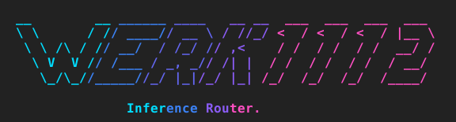

# Werk1112

  

Werk1112 is a local-first, multimodal inference runtime and router written in
Rust. Developers use one CLI and HTTP service for text, image, video and audio
workflows across compatible backends. Werk discovers models, selects an
executable backend and runs requests through the runtimes available on your
hardware. Local execution supports digital sovereignty by letting teams run
compatible inference on infrastructure they control.

Documented paths include Apple Silicon, NVIDIA CUDA and AMD Strix Halo;
see the [platform overview](#platform-overview) for requirements and validation
limits. Optional hosted adapters connect to external providers and remain subject
to their access requirements and costs.

[Install](#install) · [Quick start](#quick-start) · [HTTP service](#http-service) ·
[Documentation](#documentation)

## Why Werk1112?

- **Connect existing clients.** Use the documented OpenAI-compatible API and
  Anthropic Messages subsets through one service, with streaming and client tool
  calling. See [API coverage](docs/api.md).
- **Run local AI inference on your own hardware.** Choose compatible models,
  hardware and runtimes to support digital sovereignty and reduce reliance on
  paid hosted inference. Suitable local paths can work offline once models,
  runtimes and dependencies are provisioned; downloads and hosted APIs require
  a network.
- **Manage models across modalities.** Import existing files or pull compatible
  Hugging Face repositories into a shared [model store](docs/concepts/models-manifests-and-store.md),
  then use typed text and media commands without integrating each runtime yourself.
- **Diagnose runtime choices.** Use automatic or explicit backend selection,
  `werk inspect` and `werk doctor` to check model requirements and routing blockers.
- **Work within memory limits.** Use backend-specific CPU/GPU offload, placement
  and cache controls where implemented. [Memory capabilities](docs/concepts/runtime-persistence-and-memory.md)
  depend on the model and runtime; routing alone does not reduce memory use.
- **Serve and observe multiple models.** Retain supported workers with
  [startup preload](docs/reference/cli.md#startup-preload), inspect activity with
  `werk top`, and connect [Prometheus/Grafana](utils/observability/README.md).
  Capacity and concurrent execution remain backend- and resource-dependent.

## Platform overview

These are documented runtime paths, not blanket hardware-validation or model-fit
claims. Install the matching drivers, runtimes and model packages separately.

| Hardware / platform | Runtime path | Main requirement or limit | Guide |
| --- | --- | --- | --- |
| CPU / generic hosts | llama.cpp CPU; compatible Candle or ONNX paths | Releases target Linux x86_64, Windows x86_64 and macOS Apple Silicon; architecture, build features and runner availability still apply. | [Backend matrix](docs/backends.md#platform-support-matrix) |
| NVIDIA CUDA | llama.cpp CUDA; eligible local vLLM; compatible Python media runtimes | Linux is the primary path; Windows needs a matching CUDA toolchain, WSL2 is best effort. Local vLLM execution requires native Linux. | [Backends](docs/backends.md) |
| Apple Silicon | llama.cpp Metal, MLX/MLX-VLM and oMLX adapters | macOS and compatible model/runtime versions required; managed oMLX requires macOS 15+. | [Installation matrix](docs/backends.md#platform-aware-explicit-installation) |
| AMD Strix Halo, Ryzen AI Max/Max+ (`gfx1151`) | llama.cpp ROCm/HIP or Vulkan; operator-provisioned ROCm vLLM/Python | Native Linux x86_64; implemented integration still requires the real-hardware smoke gate. No NPU adapter. | [Strix Halo](docs/integrations/strix-halo.md) |
| NVIDIA DGX Spark / GB10 | Compatible llama.cpp CUDA and Spark vLLM environment/container | Linux aarch64 profile is Spark-specific; real GB10 smoke testing required. No native TensorRT-LLM or NIM adapter. | [DGX Spark](docs/integrations/dgx-spark.md) |

Unified memory is shared physical capacity, not additive RAM and VRAM pools.
Memory budgets and estimates do not guarantee that a model fits.
[Single-host deployment profiles](docs/concepts/single-host-deployments.md) expose
supported local CUDA multi-GPU strategies; they do not provide multi-node clusters
or mixed NVIDIA/AMD sharding. See [implementation and hardware evidence](docs/multi-gpu-progress.md).

## Install

End-user installers install the Werk binary only. Models, drivers, Python
packages and optional inference runtimes remain separate.

Linux or macOS:

~~~bash
sh -c "$(curl -fsSL https://raw.githubusercontent.com/philipbodenbach/werk1112/main/scripts/install.sh)"
~~~

Windows PowerShell:

~~~powershell
irm https://raw.githubusercontent.com/philipbodenbach/werk1112/main/scripts/install.ps1 | iex
~~~

From a source checkout with stable Rust and the [native build dependencies](docs/development/build.md):

~~~bash
cargo +stable install --path . --locked
~~~

Installer options, first-model setup and uninstall behavior are documented in
[Getting started](docs/getting-started.md).

## Quick start

First choose a text model and compatible runtime from the
[backend guide](docs/backends.md). For example, a local GGUF chat model needs a
llama.cpp build that supports its architecture. If you choose the CPU path,
`werk backend install llama-cpu` builds that runtime and requires Git, CMake and
a C/C++ compiler. Accelerator alternatives are in the platform guides above.

Replace `/absolute/path/to/model.gguf` with your compatible local model file;
`local-model` is the name this example registers:

~~~bash
werk backend list
werk backend doctor --debug
werk import /absolute/path/to/model.gguf --name local-model
werk inspect local-model
werk doctor --model local-model
werk chat local-model --max-tokens 128
~~~

Already imported? Use its ID from `werk list`. To download instead, follow
[Hugging Face pull setup](docs/getting-started.md#add-a-model), including Git LFS
and access requirements. Import or discovery alone does not prove that inference
will succeed. `--backend auto` is the default; add an explicit backend or use
`werk chat local-model --debug` when diagnosing selection.

### HTTP service

Authentication is enabled by default. Generate a key, replace the placeholder
with that key, then serve the same model (POSIX shell example):

~~~bash
werk auth api-key generate
export WERK_API_KEY="replace-with-generated-key"
werk serve --model local-model
~~~

Configure OpenAI-compatible clients with `http://127.0.0.1:11434/v1` and the key.
From another terminal with `WERK_API_KEY` set:

~~~bash
curl -fsS http://127.0.0.1:11434/v1/models \
  -H "Authorization: Bearer $WERK_API_KEY"
~~~

For several installed text models, `werk serve --preload model-a model-b`
performs ordered, best-effort loading and warmup. Successful instances remain
resident until shutdown; unsupported paths or resource failures are logged and
skipped. This does not generally warm image, video or audio generation.
See [preload semantics and limits](docs/reference/cli.md#startup-preload).

## Core capabilities

Typed commands cover chat, vision, image, video and audio workflows. Each model
placeholder below requires a compatible installed model and its runtime:

~~~bash
werk image generate IMAGE_MODEL --prompt "A quiet orbital greenhouse"
werk video generate VIDEO_MODEL --prompt "Clouds crossing a mountain ridge"
werk audio generate speech TTS_MODEL --text "Hello from Werk." --output speech.wav
~~~

See [media inference](docs/media-inference.md) and
[vision and rendered-output inspection](docs/integrations/vision.md) for tasks,
parameters and runtime requirements. Planning includes workload estimation,
parameter validation and provenance.

Save terminal conversations with `werk chat local-model --persistence --session project`.
[Conversation history](docs/reference/cli.md#persistent-terminal-chat), resident
weights, automatic prefix/KV reuse, native KV snapshots and SSD expert caches are
separate mechanisms. Native reuse is backend-dependent; KV state is not portable
between arbitrary runtimes. [Cache cleanup](docs/reference/cli.md#local-persistence-caches)
and [linked model collections](docs/concepts/models-manifests-and-store.md)
have their own storage semantics.

[Experimental oMLX SSD expert offload](docs/backends.md#experimental-omlx-expert-offload)
can substantially slow generation. Its budget limits expert-cache residency,
not total process memory: dense/shared weights, KV and workspace need additional
space. Logical read counters do not measure physical SSD throughput.
[Thinking and per-request oMLX controls](docs/api.md#omlx-chat-options) also affect
latency and remain model-dependent.

### APIs and integrations

| Surface | Contract |
| --- | --- |
| OpenAI Chat Completions and Anthropic Messages | Compatible subsets at `POST /v1/chat/completions` and `POST /v1/messages`; documented text, vision, streaming and client tool cycles. See [API coverage](docs/api.md) and [Anthropic clients](docs/integrations/anthropic-clients.md). |
| Media, jobs and files | OpenAI-inspired and Werk-native routes, plus small ComfyUI/AUTOMATIC1111 compatibility surfaces. [Documents and files](docs/integrations/documents.md) have format and runtime limits. |
| Werk Protocol 1.0 | Separate `/werk/v1` capability, state and memory controls; inspect support before using optional operations. [Protocol reference](docs/reference/werk-protocol-v1.md). |
| ComfyUI and n8n | Optional [ComfyUI nodes (Beta)](utils/comfyUI/README.md) and manually installed [n8n nodes (Beta)](utils/n8n/README.md), including native media and runtime controls. |

For digital sovereignty initiatives, the documented API subsets let existing
compatible clients connect to a self-operated Werk service.
[Tool calling](docs/tool-calling.md) exposes model-requested calls and explicit
media tool invocation; model compliance remains separate from adapter capability.
Werk remains an inference runtime/router; client applications own agent loops
and workflow execution.

## Performance examples

Historical measurements of specific implementations and workloads follow.
They measure **decode tokens per second**, excluding startup and prefill, not
end-to-end latency or a general router speedup. They are not guarantees for the
current release or other hardware.

### DeepSeek V4 Flash: static CPU/GPU placement

GGUF **Q2_K_S** on an RTX 3090 (24 GiB VRAM) and Xeon E5-2673 v3
(48 logical CPUs, 98.22 GiB WSL2 guest RAM), using llama.cpp `ec928150501c`
and CUDA 13.0: combined decode **5.93 → 7.19 tok/s** after moving five layers'
routed experts from CPU to GPU. Each variant used two requests, 128 output
tokens each, a 23-token prompt, context 4096 and 24 generation threads.
Second requests reused 19 prompt tokens; OS caches were not cleared.
See the [2026-09-19 report, raw data and reproduction](docs/benchmarks/2026-09-19-cuda-tuning/README.md).

### Qwen3.8 Flash: expert decode implementation

`pipenetwork/Qwen3.8-Flash-Next-MLX-mixed-4_8bit` on Apple Silicon with
48 GiB unified memory, macOS and oMLX 0.6.4 with experimental expert offload:
legacy → direct decode means were **6.09 → 6.26 tok/s** for first requests and
**12.06 → 12.66 tok/s** for repeats. Two samples per mode/state in ABBA order
used a 32-token prompt, 96 output tokens, a 22 GiB expert ceiling and thinking
off. Repeats had zero expert misses and reused 31 prompt tokens.
See the [2026-09-22 report, raw data and reproduction](docs/benchmarks/2026-09-22-text-decode/README.md).

These are small samples with cache effects. The Qwen artifacts do not record the
exact chip variant or effective context limit; they establish only this short
workload. The same report found no confirmed GLM full-model gain. Layer timings
and logical expert reads must not be interpreted as whole-model throughput or
physical disk bandwidth. For controlled API comparisons, see the
[chat benchmark harness](utils/benchmarks/README.md).

## Status

Werk1112 is under active development. Execution depends on architecture,
checkpoint, platform and installed runtime; discovery covers more models than
executable adapters.

### European model integrations

Optional hosted adapters for Mistral Large 4, FLUX 3 Image and Eleven v4,
Kolibri via Aleph Alpha's vLLM plugin, and FLUX 3 Action DROID predictions all
remain **`IMPLEMENTED_UNTESTED` for actual inference**. Some local/remote modes
are unavailable upstream. Use `werk support list` and the
[model support matrix](docs/model-support-matrix.md),
[audit](docs/model-support-audit.md) and
[implementation report](docs/model-support-implementation.md) for exact identities,
requirements and blockers. FLUX.1 Schnell retains its existing Diffusers path.

## What’s new in v1.10.2

Werk Core, Media Companion, ComfyUI and n8n share release version **1.10.2**.
ComfyUI and n8n remain Beta integrations.

- fix(): github page fixes (`d981d14aefd7`)

See the [v1.10.2 changelog](CHANGELOG.md#1102---2026-10-27) for all changes and compatibility notes.

## Documentation

| Need | Reference |
| --- | --- |
| Browse all guides and integrations | [Documentation index](docs/README.md) · [Published documentation](https://philipbodenbach.github.io/werk1112/documentation.html) |
| Install, manage models and diagnose a first run | [Getting started](docs/getting-started.md) · [CLI reference](docs/reference/cli.md) |
| Review runtime and task coverage | [Backends](docs/backends.md) · [Tasks and formats](docs/reference/tasks-and-formats.md) |
| Configure serving and memory | [Persistence and memory](docs/concepts/runtime-persistence-and-memory.md) · [Concurrency](docs/concepts/inference-concurrency.md) · [Environment variables](docs/reference/environment-variables.md) |
| Operate a service | [Dashboard, Prometheus and Grafana](utils/observability/README.md) |
| Review releases | [Changelog](CHANGELOG.md) · [Packaging and releases](docs/development/packaging-releases.md) |

The versioned files under `docs/` are the documentation source of truth.

## Development

See [Building from source](docs/development/build.md) for Cargo aliases, feature
bundles, native dependencies and platform prerequisites. Common checks:

~~~bash
cargo +stable fmt --all --check
cargo +stable check --all-targets
cargo +stable test
python -m unittest runtime.test_werk_media_companion
python -m pytest utils/comfyUI/tests
~~~

Optional backend dependencies stay outside the main Werk process where version
conflicts would otherwise affect unrelated architectures.

## License

Unless a file or subdirectory explicitly states otherwise, the current
Werk1112 source tree—including the core runtime, server, APIs, media
companions, utilities, and ComfyUI nodes—is licensed under the
[Elastic License 2.0](LICENSE). This repository-wide default also applies to
future integrations added here unless they explicitly declare another license.

ELv2 permits use, modification, preparation of derivative works, and
redistribution, subject to its terms. Its restrictions include not providing
the software to third parties as a hosted or managed service where users receive
access to a substantial set of the software's features or functionality. The
[`LICENSE`](LICENSE) file contains the authoritative terms.

Source versions and releases published before this licensing change remain
available under the license terms under which they were originally published.
Third-party dependencies, models, runtimes, and other materials retain their
own licenses and are not relicensed by this repository-wide default.
